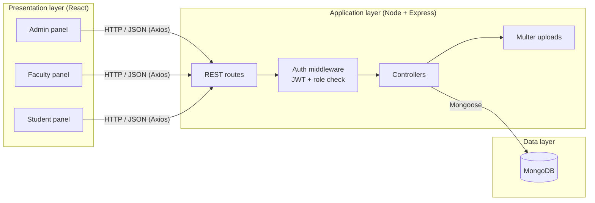
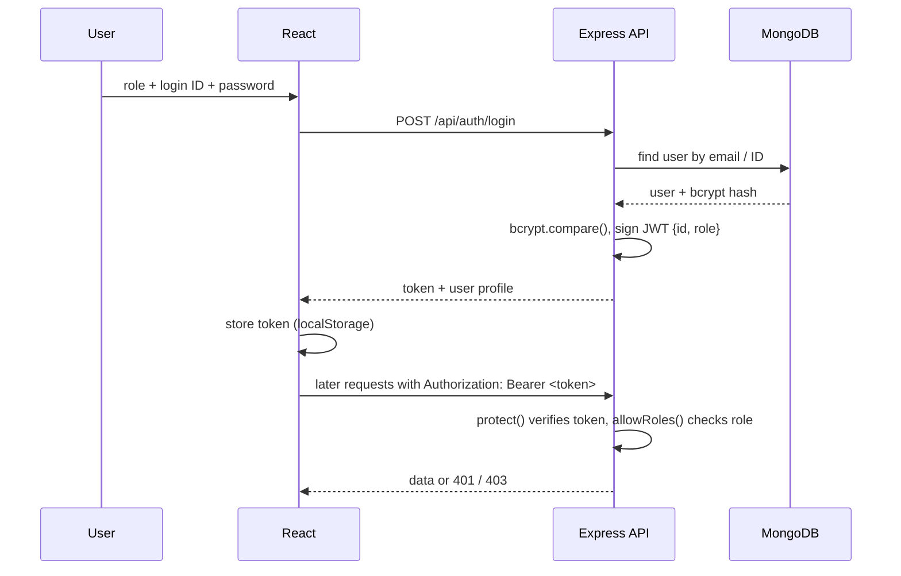

# University Management System (UMS)

A full-stack web application that brings the academic and administrative work of a university onto one platform.
It is built on the **MERN** stack: **MongoDB, Express.js, React.js and Node.js**.

Administrators, faculty members and students each get their own panel, and access is controlled with
**JWT (JSON Web Token)** authentication and role-based authorisation.

> Industrial training project · B.E. Computer Science & Engineering · Chandigarh University
> Developed by **Nikhil Singh (24BCS10116)**

---

## Features

### Home page
- Public home page with Student / Faculty / Admin login, latest notices (live from the database) and portal services

### Administrator
- Dashboard with live counts, students per branch and upcoming exams
- Student management: add / edit / delete, photo upload, search, filter by branch and semester, pagination
- Faculty management with department and designation
- Branch (department) management with HOD assignment
- Subject management: credits, theory/lab, and faculty assignment
- Examination scheduling, plus publishing or hiding results for students
- Timetable builder for any branch, semester and section
- Notices for everyone, students only or faculty only, optionally limited to one branch
- System settings: manage admin accounts and reset any user's password

### Faculty
- Dashboard with today's classes, assigned subjects and latest notices
- Search students by name, enrollment number or class
- Marks entry sheet for assigned subjects: bulk save, absent marking, live average and highest score, validation against max marks
- Timetable management
- Upload study material (PDF, DOC, PPT, XLS, ZIP, images; max 10 MB)
- Post notices for students

### Student
- Dashboard with today's classes, latest result and notice board
- Weekly timetable grid (printable)
- Marks and results, exam-wise, with percentage (only after the result is published)
- Download study material filtered by subject and type
- View notices meant for their branch

### Common
- Login using email **or** enrollment number / employee ID
- Profile page with photo upload and contact details update
- Change password with a strength indicator
- Protected routes; an expired session redirects to login automatically

---

## Tech stack

| Layer      | Technology                                                    |
| ---------- | ------------------------------------------------------------- |
| Frontend   | React 18, React Router 6, Tailwind CSS, Axios, Vite           |
| Backend    | Node.js, Express.js                                           |
| Database   | MongoDB with Mongoose ODM                                     |
| Auth       | JSON Web Token (jsonwebtoken), bcryptjs password hashing      |
| Uploads    | Multer (profile photos and study material)                    |

---

## Architecture



### Token-based authentication flow



---

## Folder structure

```
university-management-system/
├── backend/
│   ├── server.js                 # express app entry
│   ├── uploads/                  # uploaded photos & material (created at runtime)
│   └── src/
│       ├── config/db.js          # mongoose connection
│       ├── middleware/           # auth (protect, allowRoles), upload (multer), error handler
│       ├── models/               # Admin, Faculty, Student, Branch, Subject, Exam, Marks, Timetable, Notice, Material
│       ├── controllers/          # business logic for every module
│       ├── routes/               # REST endpoints
│       └── utils/                # helpers + seed script
└── frontend/
    ├── index.html
    └── src/
        ├── api/client.js         # axios instance + interceptors
        ├── context/AuthContext.jsx
        ├── components/           # layout, reusable UI, timetable grid, modals
        ├── hooks/                # useFetch, useBranches, useDebounce
        ├── pages/
        │   ├── admin/
        │   ├── faculty/
        │   ├── student/
        │   └── shared/           # profile, change password, notices, timetable manager
        └── utils/format.js
```

---

## Getting started

### Prerequisites
- Node.js 18 or above
- MongoDB running locally (`mongodb://127.0.0.1:27017`) or a MongoDB Atlas connection string

### 1. Backend

```bash
cd backend
npm install
cp .env.example .env        # on Windows: copy .env.example .env
# edit .env and set MONGO_URI and JWT_SECRET
npm run seed                # optional: loads demo data
npm run dev                 # starts API on http://localhost:5000
```

### 2. Frontend

Open a second terminal:

```bash
cd frontend
npm install
npm run dev                 # opens http://localhost:5173
```

Vite proxies `/api` and `/uploads` to `localhost:5000`, so no extra configuration is needed during development.

### Running the frontend without the backend

```bash
cd frontend
npm run dev:offline
```

In this mode (`VITE_DATA_MODE=local`) the same REST endpoints are served inside the browser by
`src/api/localServer.js` and data is kept in `localStorage`. Admin, faculty and student panels share the same data,
so a notice posted by the admin or marks published by the exam cell show up for students immediately.
Switch back to the Express + MongoDB backend with `npm run dev`.

### Demo login (after `npm run seed`)

| Role    | Login ID                   | Password     |
| ------- | -------------------------- | ------------ |
| Admin   | `admin@ums.edu`            | `admin123`   |
| Faculty | `E10231` (Dr. R. Sharma)   | `faculty123` |
| Student | `24BCS10101`               | `student123` |

The seed creates 4 branches, 6 faculty, 19 students, 11 subjects, a CSE semester 5 timetable,
MST-1 / MST-2 results, notices and sample study material.

New students and faculty added by the admin get their **enrollment number / employee ID in lowercase** as the
default password.

---

## REST API

All routes except login require the header `Authorization: Bearer <token>`.

| Method | Endpoint                         | Access                | Description                                  |
| ------ | -------------------------------- | --------------------- | -------------------------------------------- |
| POST   | `/api/auth/login`                | Public                | Login with role, login ID and password       |
| GET    | `/api/auth/me`                   | All                   | Logged-in user's profile                     |
| PUT    | `/api/auth/profile`              | All                   | Update phone / address / photo               |
| PUT    | `/api/auth/change-password`      | All                   | Change own password                          |
| GET    | `/api/admin/dashboard`           | Admin                 | Statistics for the dashboard                 |
| GET/POST | `/api/admin/admins`            | Admin                 | List / create admins                         |
| POST   | `/api/admin/reset-password`      | Admin                 | Reset a student's or faculty's password      |
| GET    | `/api/students`                  | Admin, Faculty        | Search with `search, branch, semester, section, page` |
| POST/PUT/DELETE | `/api/students/:id`     | Admin                 | Manage students                              |
| GET/POST/PUT/DELETE | `/api/faculty`      | Admin                 | Manage faculty                               |
| GET    | `/api/faculty/me/overview`       | Faculty               | Subjects, classes and counts for dashboard   |
| GET/POST/PUT/DELETE | `/api/branches`     | Read: all · Write: Admin | Branches                                  |
| GET/POST/PUT/DELETE | `/api/subjects`     | Read: all · Write: Admin | Subjects (`mine=true` for faculty)        |
| GET/POST/PUT/DELETE | `/api/exams`        | Read: all · Write: Admin | Exams and result publishing               |
| GET    | `/api/marks/sheet`               | Admin, Faculty        | Class list with existing marks               |
| POST   | `/api/marks/bulk`                | Admin, Faculty        | Save marks for many students at once         |
| GET    | `/api/marks/my`                  | Student               | Own published results                        |
| GET/PUT | `/api/timetable`                | Read: all · Write: Admin, Faculty | Weekly timetable with clash check |
| GET/POST/PUT/DELETE | `/api/notices`      | Read: all · Write: Admin, Faculty | Notices                           |
| GET/POST/DELETE | `/api/materials`        | Read: all · Upload: Faculty | Study material                         |

---

## Validation and security notes

- Passwords are hashed with bcrypt and are never returned in responses.
- Every protected route checks the token and also whether the account is still active.
- Students can only read data for their own branch and semester; this is enforced on the server, not only in the UI.
- Faculty can enter marks and upload material only for subjects assigned to them.
- Timetable saving rejects overlapping periods on the same day.
- Marks outside `0 – maxMarks` are rejected.
- Uploads are limited by file type and size.

## Future scope
- Attendance module
- Fee payment integration
- Email / SMS alerts for notices and results
- Export of result sheets to PDF / Excel
